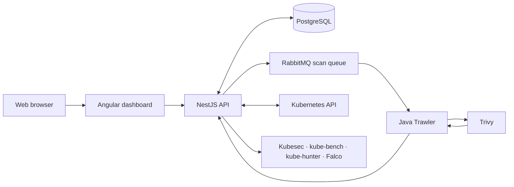

# m9sweeper-modern

**Kubernetes Security for Everyone**

[](https://github.com/sm-joe/m9sweeper-modern/releases)
[](platform/LICENSE)
[](https://github.com/sm-joe/m9sweeper-modern/issues)

**m9sweeper-modern** is an open-source Kubernetes security platform that brings container vulnerability scanning, cluster security insights, policies and reporting into one dashboard. It continues the original [m9sweeper](https://github.com/m9sweeper/m9sweeper) project with a modern application stack and actively maintained Kubernetes integration.

[**Start here — beginner guide**](docs/getting-started.md) · [**Installation**](docs/installation.md) · [**EKS step-by-step**](docs/eks-installation.md) · [**EKS / AKS / GKE guide**](docs/cloud-kubernetes.md) · [**Releases**](https://github.com/sm-joe/m9sweeper-modern/releases) · [**Report an issue**](https://github.com/sm-joe/m9sweeper-modern/issues) · [**Contribute**](CONTRIBUTING.md)

## What you can do

- **Discover clusters and workloads** — view Kubernetes clusters, namespaces, deployments, pods and images.
- **Scan container images** — identify CVEs with Trivy, review severity and track results over time.
- **Manage security policies** — configure scanning rules, decisions and exceptions.
- **Understand your security posture** — use dashboards, vulnerability trends and reports.
- **Connect additional security tools** — Kubesec, kube-bench, kube-hunter, Falco and Gatekeeper integrations are available, with configuration depending on your cluster.

## Security tools

| Tool | Purpose |
| --- | --- |
| [Trivy](https://github.com/aquasecurity/trivy) | Container image vulnerability scanning |
| [Kubesec](https://github.com/controlplaneio/kubesec) | Kubernetes manifest security analysis |
| [kube-bench](https://github.com/aquasecurity/kube-bench) | CIS benchmark assessments |
| [kube-hunter](https://github.com/aquasecurity/kube-hunter) | Kubernetes penetration testing |
| [Falco](https://falco.org/) | Runtime security events |
| [OPA Gatekeeper](https://github.com/open-policy-agent/gatekeeper) | Kubernetes security policies |

## Technology stack

| Layer | Technology |
| --- | --- |
| Frontend | Angular 22, TypeScript, Angular Material, RxJS |
| Backend | NestJS 11, Node.js, TypeScript |
| Image scanner | Java 21, Maven, Trivy |
| Persistence | PostgreSQL 17 |
| Messaging | RabbitMQ 4.4 |
| Deployment | Kubernetes, Helm 3 |
| Testing & automation | Jest, Playwright, GitHub Actions, Kind |

## Architecture



The NestJS API maintains cluster inventory, policies and scan history. Trawler processes image-scan jobs from RabbitMQ and sends Trivy results back to the API for persistence and display.

## Installation

**New to Kubernetes?** Follow the [beginner installation walkthrough](docs/getting-started.md) first. It explains each command, storage prerequisites, Secrets, Helm, how to verify success and the specific EKS PVC issue found during testing.

### Requirements

- A Kubernetes cluster and `kubectl` (Kubernetes 1.35 is the tested reference environment)
- Helm 3 and [GitHub CLI](https://cli.github.com/)
- Persistent storage provisioner (StorageClass) for PostgreSQL 17 and RabbitMQ 4.4, or existing external services

### 1. Download

```bash
mkdir -p m9sweeper && cd m9sweeper
gh release download v0.1.0 --repo sm-joe/m9sweeper-modern --pattern 'm9sweeper-*.tgz' --pattern 'create-install-secrets.py'
```

### 2. Configure

For a new install, generate matching private credentials and use the [installation guide](docs/installation.md) for the remaining values. **For upgrades, reuse the existing Secrets; never regenerate them.**

```bash
export M9_PRIVATE_DIR="$HOME/.config/m9sweeper"
export M9_ADMIN_EMAIL="your-real-admin-email@example.com"
python3 ./create-install-secrets.py --output-dir "$M9_PRIVATE_DIR"
```

Replace the email address with your real admin email. Then create the namespace and Secrets:

```bash
kubectl create namespace m9sweeper-system
kubectl -n m9sweeper-system create secret generic m9-dash-env --from-env-file="$M9_PRIVATE_DIR/dash-runtime.env"
kubectl -n m9sweeper-system create secret generic m9-init-env --from-env-file="$M9_PRIVATE_DIR/dash-bootstrap.env"
kubectl -n m9sweeper-system create secret generic m9-trawler-env --from-env-file="$M9_PRIVATE_DIR/trawler-runtime.env"
```

### 3. Install with Helm

Create a `values.yaml` file:

```yaml
global:
  installation:
    enabled: true
  postgres:
    enabled: true
  rabbitmq:
    enabled: true
dash:
  existingSecret: m9-dash-env
  init:
    existingSecret: m9-init-env
trawler:
  existingSecret: m9-trawler-env
```

Install m9sweeper:

```bash
helm upgrade --install m9sweeper ./m9sweeper-0.1.0.tgz \
  --namespace m9sweeper-system \
  --values values.yaml --timeout 15m

kubectl -n m9sweeper-system rollout status deployment/m9sweeper-dash --timeout=5m
kubectl -n m9sweeper-system rollout status deployment/m9sweeper-trawler --timeout=5m
```

### 4. Open the dashboard

```bash
kubectl -n m9sweeper-system port-forward service/m9sweeper-dash 13000:3000
```

Visit **http://localhost:13000** and sign in with your configured administrator account.

See **[EKS installation and tested scanner walkthrough](docs/eks-installation.md)**, **[Installation & configuration](docs/installation.md)** and **[Cloud Kubernetes: EKS, AKS and GKE](docs/cloud-kubernetes.md)** for cloud storage, identity, cluster access, Linux commands and real-cluster acceptance.

**Cloud authentication status:** The current published release does not yet transparently authenticate an uploaded AWS EKS, Azure AKS or GKE CLI-exec kubeconfig inside the backend. Provider-native workload identity and token refresh must be implemented and validated before cloud onboarding is marked production-ready. Do not mount workstation cloud credentials or enable arbitrary exec plugins in the container.

## Development

```text
platform/dash/frontend/     Angular application
platform/dash/backend/      NestJS API and migrations
platform/trawler/           Java scanner
platform/manifests/charts/  Helm charts
platform/docker-compose/    Local development dependencies
tools/                      Automated tests
.github/workflows/          CI and release workflows
```

For contributions, see [CONTRIBUTING.md](CONTRIBUTING.md). Please report security vulnerabilities through [SECURITY.md](SECURITY.md), not public issues.

## License and acknowledgements

Licensed under [Apache 2.0](platform/LICENSE). m9sweeper-modern builds on the original [m9sweeper](https://github.com/m9sweeper/m9sweeper) project. See [ATTRIBUTION.md](ATTRIBUTION.md) for author and license notices.
