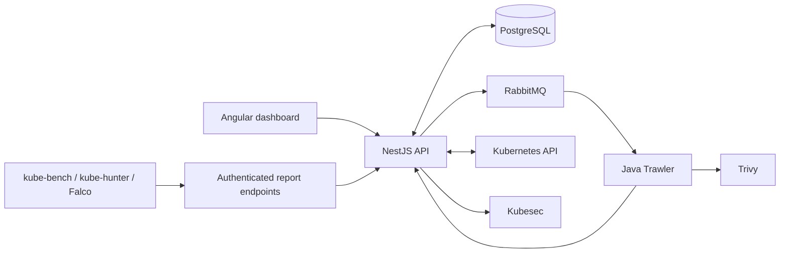

# m9sweeper-modern

**Open-source Kubernetes security scanning and visibility.**

[](https://github.com/sm-joe/m9sweeper-modern/releases)
[](platform/LICENSE)
[](https://github.com/sm-joe/m9sweeper-modern/issues)

m9sweeper-modern maintains and modernizes the original [m9sweeper](https://github.com/m9sweeper/m9sweeper) project. It combines workload inventory, vulnerability scanning, policy management and security reports in a single Kubernetes dashboard.

**Documentation:** [Quick start](docs/getting-started.md) · [Installation and upgrades](docs/installation.md) · [Amazon EKS](docs/eks-installation.md) · [Other managed Kubernetes](docs/cloud-kubernetes.md) · [Release notes](docs/release-notes.md) · [Security](SECURITY.md)

## Capabilities

| Capability | Integration | What you get |
| --- | --- | --- |
| Image vulnerability scanning | [Trivy](https://github.com/aquasecurity/trivy) | CVE findings, severity and scan history |
| Cluster inventory | Kubernetes API | Clusters, namespaces, pods, images and workloads |
| Kubernetes configuration review | [Kubesec](https://github.com/controlplaneio/kubesec) | Workload configuration findings |
| CIS checks | [kube-bench](https://github.com/aquasecurity/kube-bench) | Node security benchmark reports |
| Cluster exposure assessment | [kube-hunter](https://github.com/aquasecurity/kube-hunter) | Authenticated scan reports and findings |
| Runtime detection | [Falco](https://falco.org/) | Security events and alert history |
| Policy controls | [OPA Gatekeeper](https://github.com/open-policy-agent/gatekeeper) | Policy decisions, exceptions and review |

Each scanner requires appropriate access and configuration. A successful Helm installation alone does not demonstrate that a report was ingested.

## Technology

| Layer | Stack |
| --- | --- |
| Dashboard | Angular 22 · TypeScript · Angular Material |
| API and authorization | NestJS 11 · Node.js · TypeScript |
| Image scan worker | Java 21 · RabbitMQ · Trivy |
| Persistence | PostgreSQL 17 |
| Packaging | Helm 3 · Kubernetes 1.35–1.37 |
| Quality | Jest · Playwright · Kind · GitHub Actions |

## Architecture



Cluster synchronization discovers running workloads and queues image scans. Trawler consumes jobs, runs Trivy and submits results to the API. Auxiliary scanners submit authenticated reports to the API for persistence and dashboard visualization.

## Installation

**Prerequisites:** An accessible Kubernetes cluster, `kubectl`, Helm 3, `gh` (GitHub CLI), Python 3, and a working persistent StorageClass. All commands below run in **bash on Linux**. Verify your Kubernetes context before installation.

```bash
set -euo pipefail
kubectl config current-context
kubectl get nodes
kubectl get storageclass

mkdir -p "$HOME/m9sweeper-install"
cd "$HOME/m9sweeper-install"
gh release download v0.1.0 --repo sm-joe/m9sweeper-modern \
  --pattern 'm9sweeper-0.1.0.tgz' \
  --pattern 'create-install-secrets.py' \
  --clobber

umask 077
export M9_PRIVATE_DIR="$HOME/.config/m9sweeper"
read -r -p 'Administrator email: ' M9_ADMIN_EMAIL
export M9_ADMIN_EMAIL
python3 ./create-install-secrets.py --output-dir "$M9_PRIVATE_DIR"

kubectl create namespace m9sweeper-system
kubectl -n m9sweeper-system create secret generic m9-dash-env \
  --from-env-file="$M9_PRIVATE_DIR/dash-runtime.env"
kubectl -n m9sweeper-system create secret generic m9-init-env \
  --from-env-file="$M9_PRIVATE_DIR/dash-bootstrap.env"
kubectl -n m9sweeper-system create secret generic m9-trawler-env \
  --from-env-file="$M9_PRIVATE_DIR/trawler-runtime.env"
```

Create `values.yaml` with the existing Secret references:

```yaml
global:
  installation:
    enabled: true
  postgres:
    enabled: true
  rabbitmq:
    enabled: true
dash:
  existingSecret: m9-dash-env
  init:
    existingSecret: m9-init-env
trawler:
  existingSecret: m9-trawler-env
```

```bash
helm upgrade --install m9sweeper ./m9sweeper-0.1.0.tgz \
  --namespace m9sweeper-system --values values.yaml --timeout 15m
kubectl -n m9sweeper-system get pods,jobs,pvc
kubectl -n m9sweeper-system rollout status deployment/m9sweeper-dash --timeout=5m
kubectl -n m9sweeper-system rollout status deployment/m9sweeper-trawler --timeout=5m
kubectl -n m9sweeper-system port-forward service/m9sweeper-dash 13000:3000
```

Open **http://localhost:13000** and sign in with the administrator email/password stored in the private bootstrap file. Keep that file protected and outside version control.

The [full installation guide](docs/installation.md) covers release checksums, first-run verification, existing installations, immutable image digests and recovery. The [EKS guide](docs/eks-installation.md) covers Pod Identity, private ECR, node CIS assessments, kube-hunter private HTTPS and Falco.

## Acceptance and compatibility

**Amazon EKS:** The project operator confirmed EKS setup acceptance on **17 November 2026**, including a rendered kube-hunter report and the Trivy, kube-bench, Kubesec and Falco integrations. This is operator-reported runtime acceptance, distinct from automated CI. See the [EKS validation checklist](docs/eks-installation.md#acceptance-checklist) for evidence expected in any new environment.

**Other environments:** Cloud-hosted `exec` kubeconfigs are not automatically executable by the backend. Use cluster credentials and workload identities supported by the installation; do not upload local AWS, Azure or Google CLI secrets to the application. AKS and GKE require their own runtime testing before a comparable acceptance claim.

## Docker Compose (Linux)

For local development and end-to-end testing, the entire core application is Dockerized: the Angular/NestJS Dashboard image, Java/Trivy Trawler image, PostgreSQL 17, RabbitMQ 4.4, Kubesec and one-time bootstrap job.

```bash
cd platform/docker-compose
read -r -p 'Administrator email: ' ADMIN_EMAIL
python3 create-compose-env.py --admin-email "$ADMIN_EMAIL"
docker compose -p m9sweeper up --build -d
docker compose -p m9sweeper ps -a
```

Open **http://localhost:3000**. Read the [Docker Compose guide](platform/docker-compose/README.md) for environment setup, health checks, safe persistence and Kind networking. For existing Compose installations on older PostgreSQL/RabbitMQ major versions, back up and migrate your persistent data **before** switching images.

The Kubernetes-only kube-bench, kube-hunter and Falco sensors still require supported Kubernetes/Linux host capabilities. Their reports integrate with the Dockerized Dashboard through authenticated endpoints, but a Compose-only deployment does not emulate node sensors.

## Repository

```text
platform/dash/frontend/      Angular UI
platform/dash/backend/       NestJS API and database migrations
platform/trawler/            Java scanner
platform/manifests/charts/   Helm packages
platform/docker-compose/     Development services
tools/                       Verification and integration tests
docs/                        Installation and operations documentation
```

Developers should read [CONTRIBUTING.md](CONTRIBUTING.md). Report security issues privately using [SECURITY.md](SECURITY.md). Preserve upstream and third-party notices as described in [ATTRIBUTION.md](ATTRIBUTION.md).

Licensed under [Apache 2.0](platform/LICENSE). The original project and third-party scanners retain their respective license and trademark terms.
